# LavaCampus 

App móvil de **lavandería universitaria** con dos perfiles en el mismo dispositivo: el **Estudiante** arma pedidos, ve el total y la fecha de entrega, sigue el estado de su ropa y la recoge en un casillero; el **Administrador** recibe los pedidos, los avanza de estado, asigna el casillero, cobra, administra las tarifas y consulta a sus clientes.

Ambos perfiles comparten la misma base de datos Room: cuando el administrador marca un pedido como *Listo*, el estudiante lo ve con su casillero al instante.

> Laboratorio MVVM + Room · Programación en Móviles · TECSUP · Semana 08
> **Autor:** Becker Yldefonso Solis· **Docente:** Juan León S.

---

## Tecnologías

| Área | Tecnología |
|---|---|
| Lenguaje y UI | Kotlin + Jetpack Compose + Material 3 (sin XML) |
| Arquitectura | MVVM + Repository (interface) |
| Base de datos | Room 3 (`androidx.room3`) con `BundledSQLiteDriver`, KSP |
| Preferencias | DataStore (perfil activo, modo oscuro, avisos, recibir pedidos) |
| Navegación | Navigation Compose |
| Gráficos y seguimiento | Canvas (dona, barras, stepper de estado, íconos de servicio) |
| Fechas | `java.time` (`minSdk 26`) |

---

## Arquitectura MVVM + Repository

```
VIEW (Composable)
  │ eventos (clics)            ▲ collectAsState()
  ▼                            │
VIEWMODEL (StateFlow + reglas de negocio)
  │ llama                      ▲ Flow / resultados
  ▼                            │
LavaRepository (interface)
  │ la implementa
  ▼
LavaRepositoryRoom ──► DAO ──► SQLite (lavacampus.db)

DataStore (solo preferencias) ──► ViewModel
```

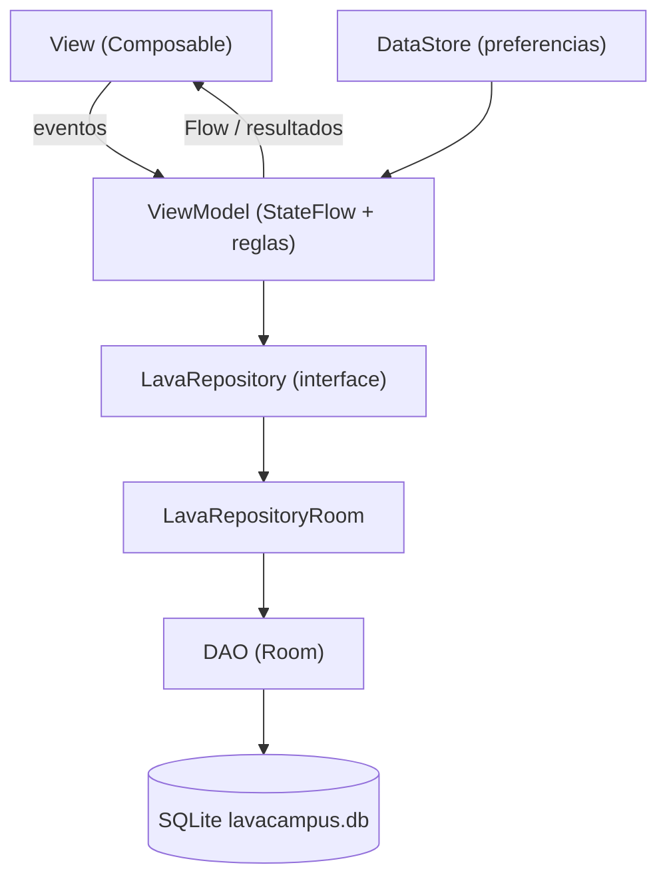

| Capa | Conoce a | No debe |
|---|---|---|
| View (`ui/`) | Solo a su ViewModel | Usar DAO, Repository ni reglas de negocio |
| ViewModel | Solo al Repository (interface) | Conocer Composables ni el DAO |
| Repository | Los DAOs (en la implementación) | Conocer pantallas ni ViewModels |
| DAO / Room | SQL y entidades | Conocer ViewModels |

**Regla de oro:** lectura que debe actualizar la pantalla → `Flow` (sin `suspend`). Escritura o acción única → `suspend`.

---

## Base de datos (4 tablas)

| Tabla | Descripción | Relación |
|---|---|---|
| `usuarios` | Estudiantes y administrador (`rol`: CLIENTE / ADMIN) | — |
| `servicios` | Lavado y secado, planchado, lavado en seco, edredón (precio, unidad, horas de entrega, activo, ícono) | — |
| `pedidos` | Estado, total, casillero, pagado, fechas de registro y entrega | N pedidos → 1 estudiante |
| `detalles_pedido` | Líneas del pedido con `precioUnitario` y `subtotal` congelados | N detalles → 1 pedido, N → 1 servicio |

Room agrega además `room_master_table` (tabla interna con el hash del esquema).

---

## Reglas de negocio (viven en los ViewModels)

- El estudiante solo ve **sus** pedidos; el administrador ve todos.
- Cantidades: **KG** de 1.0 a 10.0 en pasos de 0.5; **PRENDA** y **UNIDAD** enteros de 1 a 30. Solo servicios activos.
- Máximo **3 pedidos activos** por estudiante (RECIBIDO, EN_PROCESO o LISTO).
- `subtotal = cantidad × precio`; `total = suma de subtotales`, congelados en el pedido.
- **Fecha de entrega** = hoy + mayor tiempo de entrega (24 h = 1 día). La lavandería no atiende domingos: si cae domingo, pasa al lunes.
- El pedido y todas sus líneas se guardan en **una transacción** (`withWriteTransaction`).
- Estados: `RECIBIDO → EN_PROCESO → LISTO → ENTREGADO`, un paso a la vez y sin retroceso.
- Pasar a **LISTO** exige un casillero `C-01` a `C-30` que no esté usado por otro pedido LISTO.
- Pasar a **ENTREGADO** exige que el pedido esté **cobrado**.
- Cancelar: el estudiante solo desde RECIBIDO; el administrador desde RECIBIDO o EN_PROCESO.
- Un servicio que ya aparece en algún pedido **no se elimina**, solo se desactiva.
- Si el administrador apaga "Recibir pedidos", el estudiante no puede crear pedidos.

---

## Estructura de paquetes

```
com.yldefonso.lavacampus
├── MainActivity.kt
├── LavaApp.kt                      crea base, repository y preferencias
│
├── data
│   ├── local
│   │   ├── entity      Servicio · Usuario · Pedido · DetallePedido
│   │   ├── dao         ServicioDao · UsuarioDao · PedidoDao · DetalleDao
│   │   ├── relation    DetalleConServicio · PedidoConDetalle
│   │   ├── LavaDatabase.kt
│   │   └── DatosIniciales.kt
│   ├── repository      LavaRepository (interface) · LavaRepositoryRoom
│   └── prefs           PreferenciasStore (DataStore)
│
├── model               Rol · EstadoPedido · Unidad · LineaPedido
│                       IngresoServicio · ClienteResumen · Casilleros
│
├── viewmodel           SesionViewModel · InicioViewModel · NuevoPedidoViewModel
│                       DetallePedidoViewModel · MisPedidosViewModel · PerfilViewModel
│                       PanelViewModel · BandejaViewModel · GestionPedidoViewModel
│                       ServiciosViewModel · ClientesViewModel
│                       ReglasPedido · LavaViewModelFactory
│
└── ui
    ├── theme           Color · Type · Theme (turquesa estudiante / violeta admin / modo oscuro)
    ├── components      AppTopBar · LavaButton · LavaTextField · EstadoPedidoChip · PedidoCard
    │                   StepperEstado · IconoServicio · SelectorCantidad · SelectorPildora
    │                   BarraNavEstudiante · BarraNavAdmin · ComponentesPerfil · Formato
    │   └── graficos    DatoGrafico · GraficoDona · GraficoBarras
    ├── navigation      Rutas · NavLava
    ├── estudiante      Splash · Login · Inicio · NuevoPedido · DetallePedido
    │                   MisPedidos · Tarifas · Perfil
    └── administrador   Panel · Bandeja · GestionPedido · Servicios
                        FormularioServicio · Clientes · Ajustes
```

---

## Capturas
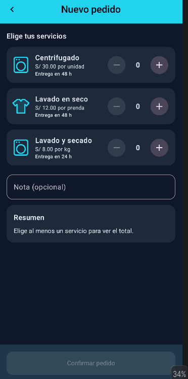
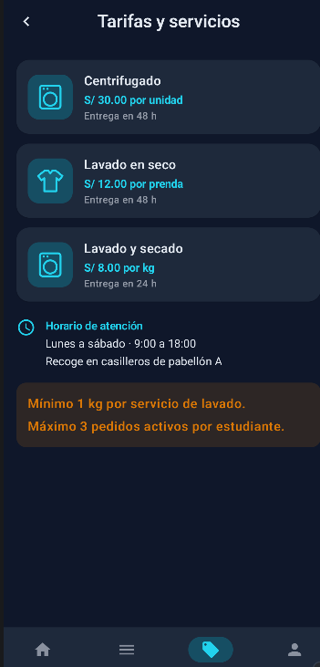
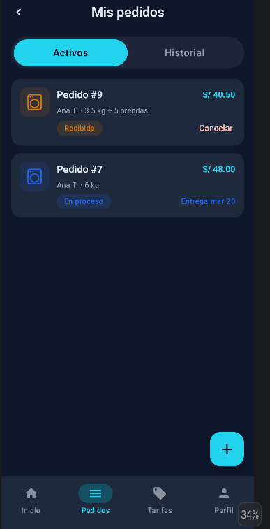
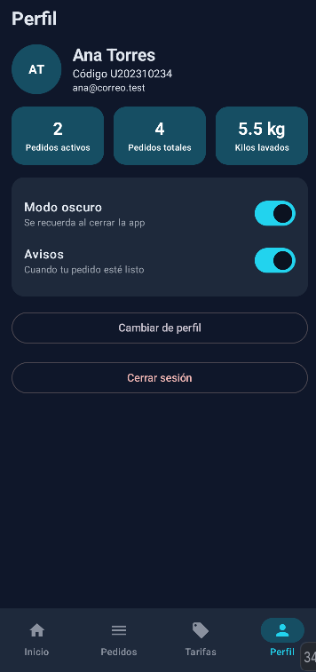
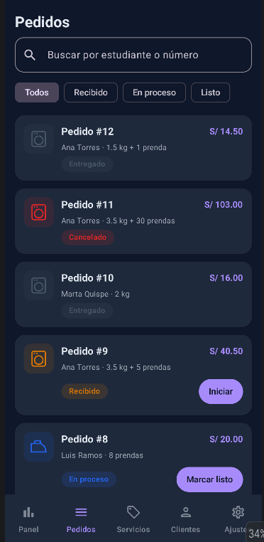
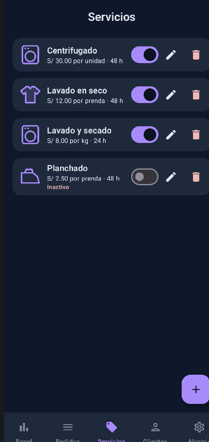
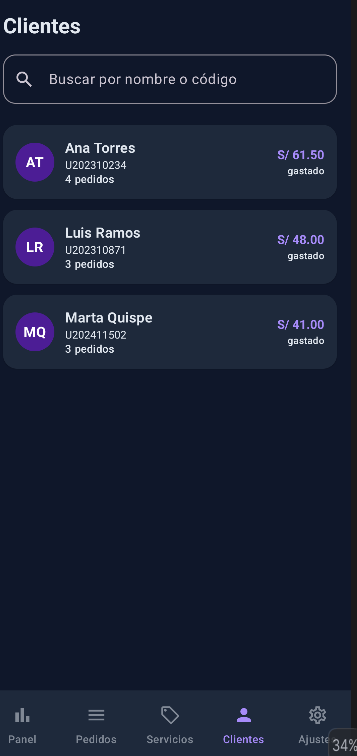
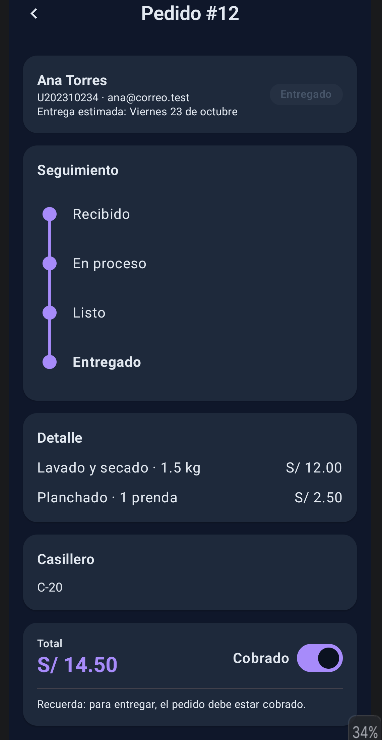
### Estudiante

| Inicio | Nuevo pedido | Mis pedidos |
|:---:|:---:|:---:|

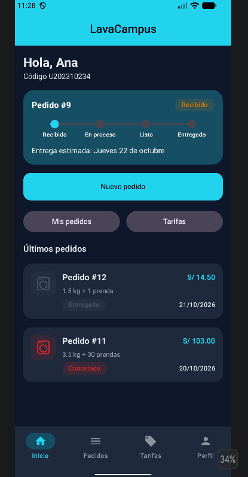
### Administrador

| Panel | Bandeja | Gestión del pedido |
|:---:|:---:|:---:|
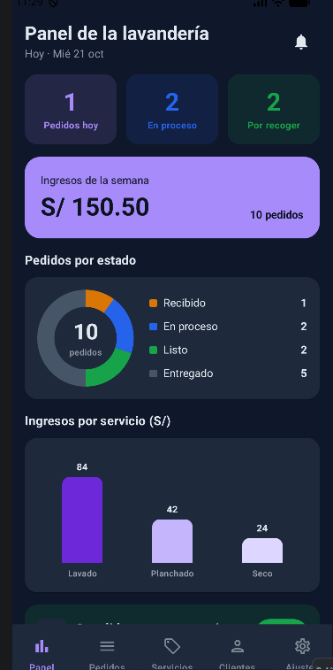

---

## Cómo ejecutarla

1. Abrir el proyecto en Android Studio y sincronizar Gradle.
2. Ejecutar en un emulador o dispositivo con **API 26 o superior**. Si ya había una versión instalada con otro esquema de base de datos, desinstalarla primero.
3. Datos de prueba (ficticios, Ley 29733):

| Perfil | Correo | Clave |
|---|---|---|
| Estudiante | `ana@correo.test` | `1234` |
| Estudiante | `luis@correo.test` | `1234` |
| Estudiante | `marta@correo.test` | `1234` |
| Administrador | `admin@lavacampus.test` | `admin` |

---

## Para pensar

**1. ¿Por qué un pedido tiene sus detalles en otra tabla (`detalles_pedido`)?**
Porque un pedido puede incluir varios servicios (por ejemplo, lavado y planchado). Guardar cada línea como una fila evita columnas repetidas (`servicio1`, `servicio2`, …) y no limita cuántos servicios puede tener un pedido. Además permite consultas como el ingreso por servicio con `JOIN` y `GROUP BY`. Es una relación uno a muchos: un pedido, muchas líneas.

**2. ¿Por qué se guardan `precioUnitario` y `subtotal` en el detalle si ya existe el precio del servicio?**
Porque el precio del servicio puede cambiar. Si mañana sube el kilo, los pedidos antiguos deben conservar lo que costaron realmente y los ingresos del panel no deben alterarse. El detalle guarda una "foto" del precio del momento.

**3. ¿Por qué `crearPedido` va dentro de una transacción?**
Porque guardar un pedido implica varias escrituras (el pedido y todas sus líneas). Si una falla, la transacción deshace también las anteriores y no queda un pedido sin detalles ni un total que no coincide con sus líneas.

**4. ¿Cuándo usar `Flow` y cuándo `suspend`?**
Si la función **lee datos que deben actualizar la pantalla cuando cambian**, devuelve un `Flow` (sin `suspend`): Room vuelve a emitir cada vez que cambia la tabla. Si **cambia datos una sola vez** o es una acción puntual (insertar, actualizar, contar), es `suspend`. No se reemplazan, se complementan. Así, cuando el administrador marca un pedido como Listo, la pantalla del estudiante se actualiza sola.

**5. ¿Por qué el Repository es una `interface`?**
Para que los ViewModels dependan de un contrato y no de Room. Más adelante el Repository se podrá conectar a un servicio web o a la nube creando otra implementación, sin cambiar ViewModels ni pantallas.

**6. ¿Por qué las reglas de negocio viven en el ViewModel y no en la pantalla ni en el DAO?**
La pantalla solo debe mostrar y avisar; si tuviera reglas, habría que duplicarlas en cada pantalla y no se podrían probar sin interfaz. El DAO solo habla SQL. En el ViewModel hay un único lugar donde se decide, por ejemplo, si un pedido puede pasar a Listo (casillero libre) o a Entregado (ya cobrado), y el Repository solo guarda lo que se le indica.

**7. ¿Por qué DataStore para las preferencias y no Room?**
DataStore sirve para datos pequeños de clave y valor (perfil activo, modo oscuro, avisos). Los pedidos, servicios y usuarios son datos con relaciones y consultas, y por eso van en Room.

---

## Decisiones técnicas

- **Room 3** (`androidx.room3`) en lugar de Room 2.6.1: usa `BundledSQLiteDriver`, `@Relation` con `parentColumns`/`entityColumns` y `withWriteTransaction` para las transacciones.
- **`ReglasPedido`**: reúne las reglas de la máquina de estados (casillero libre, cobro previo, quién cancela) en un solo lugar, usado por `GestionPedidoViewModel`.
- **Navegación entre pestañas** con una sola función (`irATab`) para botones y barra inferior, de modo que siempre se pueda volver al inicio.
- **Edición de servicios** con `@Update`, porque `INSERT OR REPLACE` borraría el servicio y chocaría con las claves foráneas de los pedidos que ya lo usan.