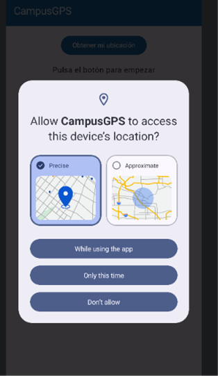
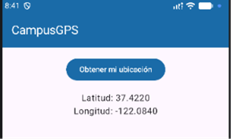
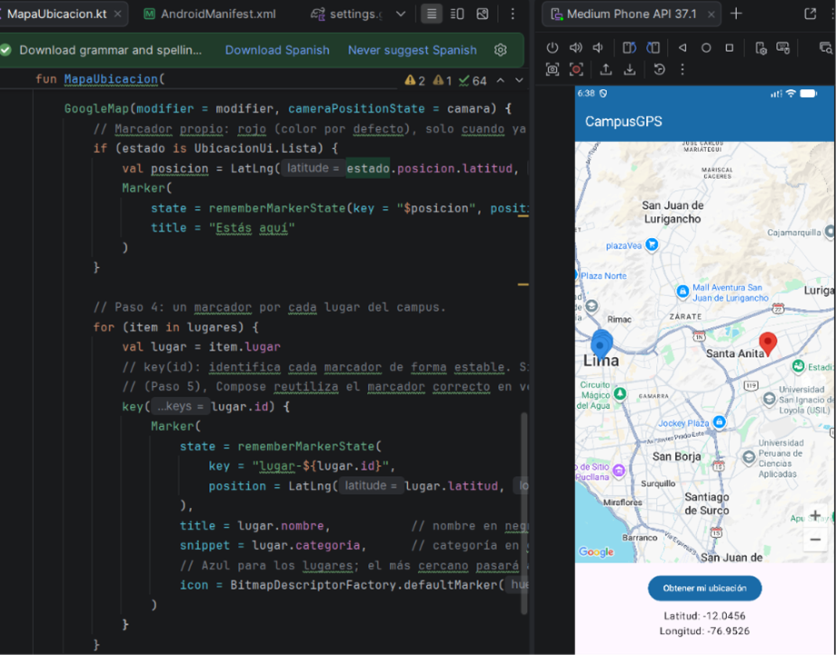
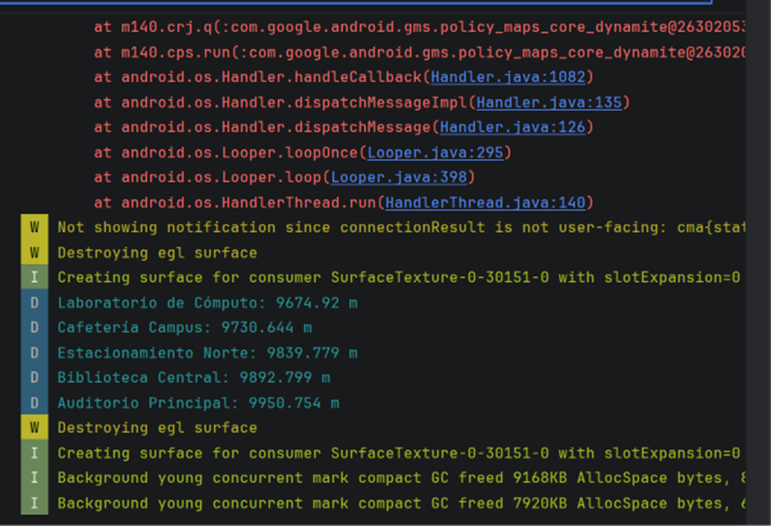
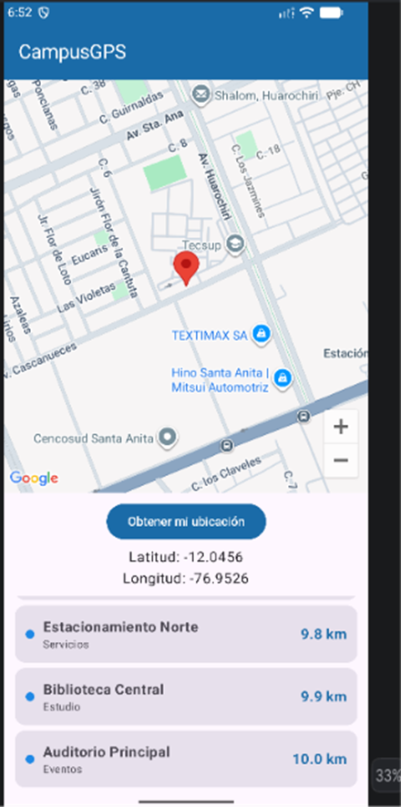
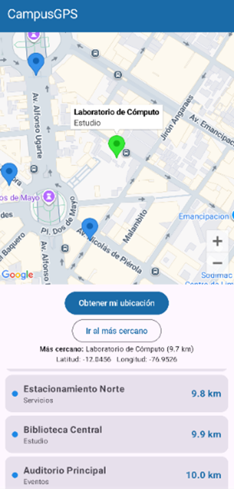
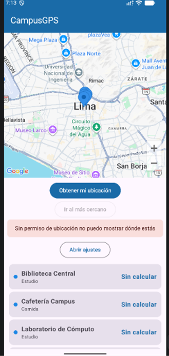
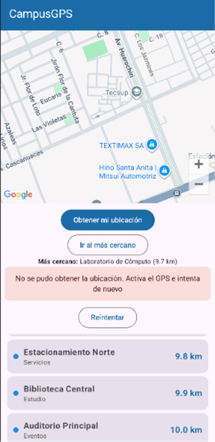
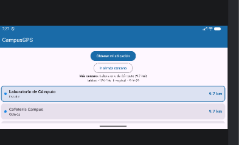

Primera apertura y pulsar el botón

Ubicación en el punto base

Tocar un marcador

Lista de lugares

Tocar una tarjeta

Ir al mas cercano

Ubicación apagada y gps desactivado

Al rotar no se pierde la ubicacion ni la lista

